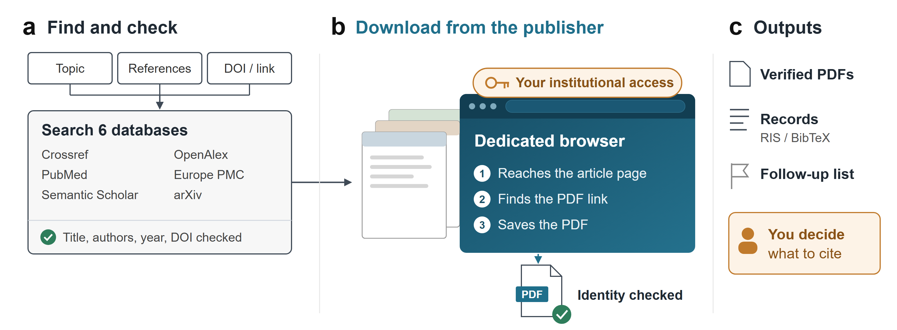

# ScholarFetch

[English](README.md) | **简体中文**

给 ScholarFetch 一个研究主题、一份文献列表或一个 DOI，它返回经过核验的文献记录和出版社官方 PDF。这个 Skill 及其命令行工具分三个阶段工作：

1. **检索** Crossref、PubMed、OpenAlex、Europe PMC、Semantic Scholar 和 arXiv，合并重复记录，形成附来源记录的候选列表。
2. **核验** 题名、作者、年份和 DOI，与所给文献逐项比对，标出冲突和缺失字段。
3. **下载** 只从官方出版社获取 PDF；无法直接获取的页面由专用浏览器处理。每份 PDF 经身份核对后才被接受。

所有结果和失败都有记录。



## 入口

给出主题时运行完整流程，已有文献列表从核验开始，DOI 或出版社链接直接进入下载。核验通过的记录可导出为 RIS 或 BibTeX。

检索结果是候选文献：书目信息匹配、PDF 身份确认与论文能否支撑论点是不同判断，引用的选择仍由使用者决定。在 Word 中写入引用由 [Zotero-Word-AutoCite](https://github.com/LiX-Works/Zotero-Word-AutoCite) 完成。

## 开始使用

在仓库根目录安装并检查环境：

```bash
python -m pip install .
literature-workflow doctor --mode all
```

- 基础安装（Python 3.11 及以上）覆盖检索、核验、直接下载和 PDF 检查。
- 浏览器路线可选：运行 `python -m pip install ".[browser]"` 并准备 cloakbrowser 浏览器二进制。未安装时其他步骤照常运行。
- 部分来源需要配置，例如 PubMed 需要 `PUBMED_EMAIL`；`doctor` 会报告缺失项。
- 受限论文使用你已有的出版社访问权限。

不需要 MCP、外部大模型或付费中转。项目不附带账号、Cookie、浏览器 profile 或浏览器二进制。详见[安装与依赖](references/setup.md)。

把仓库以 `scholarfetch` 为名放进 Agent 的 Skill 目录（Codex 通常是 `~/.codex/skills/scholarfetch/`），然后直接说：

```text
使用 $scholarfetch，查找二维材料中激子的近年研究，
说明检索来源和范围，核对候选论文，并下载其官方 PDF。
```

可以指定年份、数量、是否包含预印本和输出目录。输入可以是文本、JSON、CSV，或含 DOI 的 RIS/BibTeX；见[使用示例](examples/requests.md)。同样的步骤也可以直接用命令行运行：

```bash
literature-workflow search "exciton transport two dimensional materials" --sources crossref,europe_pmc --rows 3 --language zh --output runs/search
literature-workflow verify --doi "10.1371/journal.pone.0000308" --language zh --output runs/verify
literature-workflow download --input papers.txt --no-browser --language zh --output runs/download
literature-workflow search-download "exciton transport two dimensional materials" --rows 3 --no-browser --language zh --output runs/search-download
literature-workflow export --input runs/search-download/records.json --format ris --language zh --output runs/export
```

每次使用新的或空的输出目录，已有结果不会被覆盖。如需核对原引用而不只是回查 DOI，可加 `--expected-title` 和 `--expected-year`。完整参数见 `--help`。

## 结果与边界

每次运行生成 `run.json`、`records.json` 和 `report.md`。下载还会生成 `download_manifest.json`，通过检查的 PDF 放入 `papers/`；未取得或身份不确定的项目连同原因保留在记录和报告中。导出生成 `references.ris` 或 `references.bib`。字段与状态见[工作流契约](references/workflow-contract.md)。

检索有数量边界，不保证穷尽数据库。自动获取只接受可核实的官方出版社来源，不回退到仓储或第三方副本。浏览器每次使用全新的独立 profile，凭据只留在本地。

## 已验证的范围

65 项离线测试通过，覆盖来源异常、标识符与版本冲突、PDF 身份检查、禁止覆盖和敏感信息处理。Crossref 与 Europe PMC 的真实运行完成了检索 → 核对 → 下载 → RIS 导出的完整链路，取得一份验收通过的官方 PDF。冲突记录不进入导出，RIS/BibTeX 中的签名 URL 参数和邮件信息已去除。

浏览器路线以及 PubMed、arXiv、OpenAlex、Semantic Scholar 尚未完成本版本的联网回归。上述验证不代表所有来源或出版社均可用。

## 来源与许可

本项目整合 [nature-academic-search](https://github.com/wp-a/nature-academic-search) 的检索与核验代码、[K-Dense Scientific Agent Skills](https://github.com/K-Dense-AI/scientific-agent-skills) 中 `paper-lookup` 的数据源操作知识，以及官方 PDF 下载流程。本项目新增统一命令入口、阶段衔接、依赖诊断与可追踪输出。上游知识覆盖不代表所有数据源都已接入。

本项目新代码按 [MIT](LICENSE) 许可发布；上游代码与运行依赖保留各自许可。贡献归属与保留的许可文本见 [第三方记录](THIRD_PARTY_NOTICES.md)。
